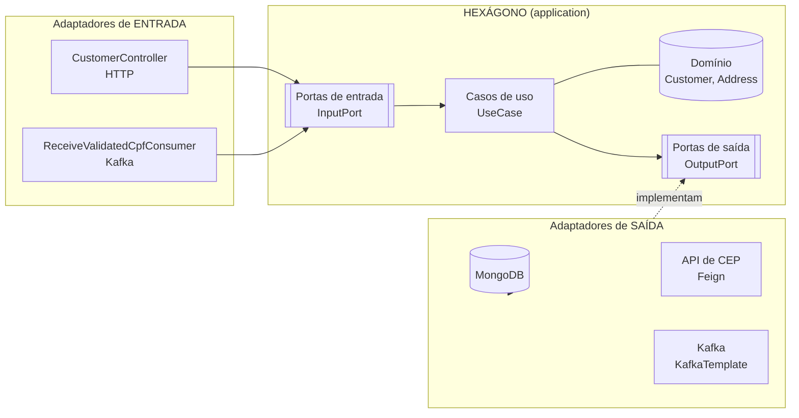
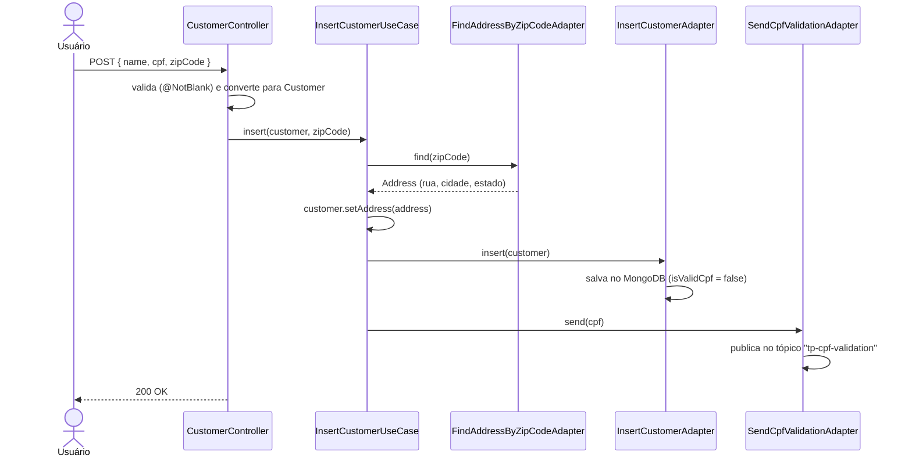
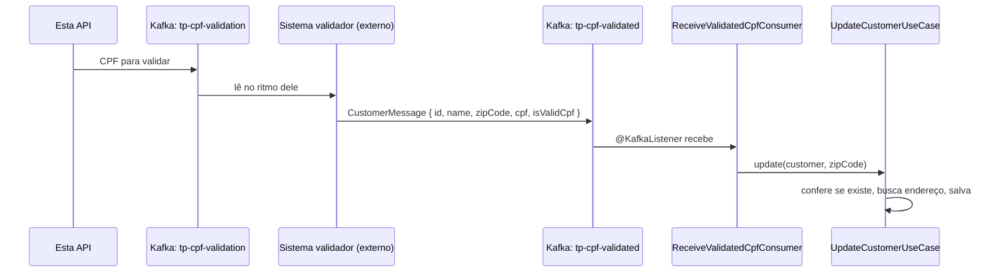

# Hexagonal — API de Clientes com Arquitetura Hexagonal

API REST de cadastro de clientes feita com **Java 21 + Spring Boot 4**, organizada em **Arquitetura Hexagonal (Ports & Adapters)**. Usa **MongoDB** como banco, **Kafka** para mensageria, uma API externa de CEP (simulada com **WireMock**) e **ArchUnit** para garantir que a arquitetura seja respeitada.

> Projeto construído acompanhando o curso *"Arquitetura Hexagonal/Ports and Adapters NA PRÁTICA"* (Danilo Arantes).

---

## Sumário

1. [O que o sistema faz](#1-o-que-o-sistema-faz)
2. [Tecnologias](#2-tecnologias)
3. [A arquitetura: Hexagonal](#3-a-arquitetura-hexagonal)
4. [Estrutura de pastas](#4-estrutura-de-pastas)
5. [Os fluxos, passo a passo](#5-os-fluxos-passo-a-passo)
6. [MongoDB](#6-mongodb)
7. [Kafka](#7-kafka)
8. [API de CEP e WireMock](#8-api-de-cep-e-wiremock)
9. [Tratamento de erros](#9-tratamento-de-erros)
10. [Testes de arquitetura (ArchUnit)](#10-testes-de-arquitetura-archunit)
11. [Como rodar](#11-como-rodar)
12. [Endpoints](#12-endpoints)
13. [Limitações conhecidas e próximos passos](#13-limitações-conhecidas-e-próximos-passos)
14. [Glossário](#14-glossário)

---

## 1. O que o sistema faz

Imagine uma loja que precisa manter uma lista de clientes. Esta API permite:

| Ação | Como |
|---|---|
| **Cadastrar** um cliente | Envia nome, CPF e CEP. O sistema descobre o endereço sozinho pelo CEP. |
| **Consultar** um cliente | Pelo id. |
| **Atualizar** um cliente | Pelo id, com novos dados. |
| **Excluir** um cliente | Pelo id. |
| **Validar o CPF** | Em segundo plano: depois do cadastro, o CPF é enviado para outro sistema validar; quando a resposta chega, o cliente é atualizado. |

O ponto principal do projeto **não é a funcionalidade** (que é simples), e sim **como o código está organizado** para ser fácil de testar, manter e evoluir.

---

## 2. Tecnologias

| Tecnologia | Para que serve aqui |
|---|---|
| **Java 21** | Linguagem |
| **Spring Boot 4** | Framework que sobe o servidor web, injeta dependências e integra tudo |
| **Spring Web MVC** | Cria os endpoints REST (`/api/v1/customers`) |
| **Spring Data MongoDB** | Acesso ao banco MongoDB sem escrever queries |
| **Spring Kafka** | Enviar e receber mensagens no Kafka |
| **Spring Cloud OpenFeign** | Chamar a API de CEP declarando só uma interface |
| **Bean Validation** | Valida a entrada (`@NotBlank` em nome, CPF e CEP) |
| **MapStruct** | Gera automaticamente o código que converte um objeto em outro (ex.: `CustomerRequest` → `Customer`) |
| **Lombok** | Gera getters/setters/construtores (`@Data`) para não escrever código repetitivo |
| **ArchUnit** | Testes que garantem que a arquitetura não seja quebrada |
| **Docker Compose** | Sobe Kafka e WireMock com um comando |
| **WireMock** | Finge ser a API de CEP, para desenvolver sem depender de um serviço real |
| **Gradle** | Build e gerenciamento de dependências |

---

## 3. A arquitetura: Hexagonal

### 3.1 A ideia em uma analogia

Pense num **videogame**:

- **Dentro** fica o processador rodando o jogo. Ele não sabe se você está usando um controle de PlayStation, de Xbox ou um teclado.
- **Por fora** existem **portas** (USB, HDMI) — um padrão, um contrato.
- Você liga qualquer **adaptador** que siga esse padrão: controle, TV, monitor.

Trocar a TV não exige abrir o console. Só plugar outra coisa na mesma porta.

A Arquitetura Hexagonal faz isso com código:

| Videogame | Neste projeto |
|---|---|
| Processador (o jogo) | `application/core` — **regras de negócio** |
| Portas USB/HDMI | `application/ports` — **interfaces** (contratos) |
| Controle, TV | `adapters` — **Spring, MongoDB, Kafka, HTTP** |

O nome "hexágono" é só o desenho: o núcleo fica no centro e cada lado é uma porta. Não tem nada de especial no número 6.

### 3.2 A regra de ouro

> **O núcleo não conhece o mundo de fora. O mundo de fora conhece o núcleo.**

As dependências sempre **apontam para dentro**:



- **Porta de entrada (`InputPort`)**: "o que o mundo pode pedir ao sistema". É implementada pelo **UseCase** e chamada pelo **Controller** ou **Consumer**.
- **Porta de saída (`OutputPort`)**: "o que o sistema precisa do mundo". É **declarada** pelo núcleo e **implementada** pelos **Adapters** (Mongo, Feign, Kafka).

Isso é a **Inversão de Dependência** (o "D" do SOLID):

```
Sem hexagonal:   UseCase ──depende de──▶ MongoRepository
Com hexagonal:   UseCase ──depende de──▶ OutputPort ◀──implementa── Adapter (Mongo)
```

### 3.3 Por que usar

1. **Testar sem infraestrutura** — os casos de uso são classes Java puras. Dá para testá-los com `new` e implementações falsas das portas, sem banco, sem Kafka, sem subir o Spring.
2. **Trocar tecnologia sem dor** — trocar MongoDB por PostgreSQL, ou Feign por outro cliente HTTP, mexe só em `adapters/out`. O núcleo não muda.
3. **Várias entradas, uma regra** — o cadastro/atualização pode vir por HTTP **ou** por Kafka chamando a **mesma** porta de entrada. Isso já acontece aqui: o `UpdateCustomerInputPort` é usado pelo Controller e pelo Consumer.
4. **Negócio legível** — abrir `usecase/` mostra o que o sistema faz, sem ruído de framework.
5. **Disciplina garantida por teste** — o ArchUnit falha o build se alguém quebrar as regras.

### 3.4 Quando usar (e quando não)

**Vale a pena** quando há regras de negócio reais, o sistema vai viver anos, várias pessoas vão mexer, e há chance real de trocar ou somar integrações.

**É exagero** para CRUDs simples, protótipos ou scripts descartáveis. Um CRUD tradicional (Controller → Service → Repository) faria o mesmo com ~5 classes; aqui são ~50. Esse custo é um "seguro" que só compensa se a flexibilidade for usada.

### 3.5 Por que existem 3 "versões" do cliente

| Classe | Camada | Representa |
|---|---|---|
| `CustomerRequest` / `CustomerResponse` | adapter de entrada (HTTP) | O formato do **JSON** da API — contrato com quem consome a API |
| `Customer` | núcleo (domínio) | O que é um cliente **para o negócio** — Java puro |
| `CustomerEntity` | adapter de saída (Mongo) | Como o cliente é **gravado no banco** (`@Document`, `@Id`) |
| `CustomerMessage` | adapter de entrada (Kafka) | O formato da **mensagem** que chega pelo Kafka |

Assim, mudar o JSON da API ou o formato no banco **não mexe no domínio**. Os **Mappers** (MapStruct) fazem a conversão entre elas.

---

## 4. Estrutura de pastas

```
src/main/java/com/woolley/hexagonal/
│
├── HexagonalApplication.java            ← ponto de partida (main)
│
├── application/                         ← O HEXÁGONO — sem Spring, sem Mongo, sem Kafka
│   ├── core/
│   │   ├── domain/                      ← Customer, Address
│   │   ├── usecase/                     ← Insert / Find / Update / DeleteCustomer...UseCase
│   │   └── exceptions/                  ← ObjectNotFoundException
│   └── ports/
│       ├── in/                          ← *InputPort  (o que o sistema oferece)
│       └── out/                         ← *OutputPort (o que o sistema precisa)
│
├── adapters/                            ← O MUNDO DE FORA
│   ├── in/
│   │   ├── controller/                  ← CustomerController (REST)
│   │   │   ├── request/                 ← CustomerRequest (JSON de entrada)
│   │   │   ├── response/                ← CustomerResponse, AddressResponse (JSON de saída)
│   │   │   ├── mapper/                  ← CustomerMapper
│   │   │   └── handler/                 ← ApiExceptionHandler, StandardError (erros HTTP)
│   │   └── consumer/                    ← ReceiveValidatedCpfConsumer (Kafka)
│   │       ├── message/                 ← CustomerMessage
│   │       └── mapper/                  ← CustomerMessageMapper
│   └── out/
│       ├── *Adapter.java                ← implementam as OutputPorts
│       ├── repository/                  ← CustomerRepository (Mongo), entity/, mapper/
│       └── client/                      ← FindAddressByZipCodeClient (Feign), response/, mapper/
│
└── config/                              ← "fiação": cria os UseCases e configura o Kafka
```

### Por que existe a pasta `config`

Os casos de uso **não têm `@Component`** de propósito — se tivessem, o núcleo dependeria do Spring. Então alguém precisa criá-los e entregar os adapters certos a eles. Esse é o papel das classes `*Config`:

```java
@Bean
public InsertCustomerUseCase insertCustomerUseCase(FindAddressByZipCodeAdapter findAddress,
                                                   InsertCustomerAdapter insertCustomer,
                                                   SendCpfValidationAdapter sendCpf) {
    return new InsertCustomerUseCase(findAddress, insertCustomer, sendCpf);
}
```

É o **único lugar** onde núcleo e adapters se encontram.

---

## 5. Os fluxos, passo a passo

### 5.1 Cadastrar cliente — `POST /api/v1/customers`



### 5.2 Validação de CPF (assíncrona, via Kafka)



O sistema validador **não faz parte deste projeto** — é outro serviço. Para testar localmente, dá para publicar a mensagem de resposta manualmente (ver [seção 11](#11-como-rodar)).

### 5.3 Consultar — `GET /api/v1/customers/{id}`

Controller → `FindCustomerByIdUseCase` → `FindCustomerByIdAdapter` → MongoDB. Se não existir, o caso de uso lança `ObjectNotFoundException` e a API responde **404** (ver [seção 9](#9-tratamento-de-erros)).

### 5.4 Atualizar — `PUT /api/v1/customers/{id}`

Controller → `UpdateCustomerUseCase`: confirma que o cliente existe (reaproveitando o `FindCustomerByIdInputPort`), busca o novo endereço pelo CEP e salva. Responde **204 No Content**.

### 5.5 Excluir — `DELETE /api/v1/customers/{id}`

Controller → `DeleteCustomerByIdUseCase`: confirma que existe e apaga. Responde **204 No Content**, ou **404** se não existir.

---

## 6. MongoDB

**O que é:** um banco de dados **NoSQL orientado a documentos**. Em vez de tabelas com linhas e colunas, guarda documentos parecidos com JSON. O endereço fica **dentro** do cliente, sem precisar de outra tabela:

```json
{
  "_id": "6ad7ae8645021fca91633edd",
  "name": "Ana",
  "cpf": "12345678900",
  "isValidCpf": false,
  "address": { "street": "Rua Hexagonal", "city": "Sao Paulo", "state": "SP" }
}
```

**Como é usado aqui:**

- Conexão em `application.yml`: `mongodb://localhost:27017/hexagonal` (banco `hexagonal`).
- `CustomerEntity` com `@Document(collection = "customers")` define a "coleção" (equivalente a uma tabela).
- `CustomerRepository extends MongoRepository<CustomerEntity, String>` — só com essa interface o Spring já entrega `save`, `findById`, `deleteById` etc., sem escrever código.
- Quem usa o repositório são **apenas** os adapters de saída (`InsertCustomerAdapter`, `FindCustomerByIdAdapter`, `UpdateCustomerAdapter`, `DeleteCustomerByIdAdapter`). O núcleo nunca sabe que o banco é Mongo.

**Por que Mongo:** o cliente é um documento autocontido (cliente + endereço), o que encaixa bem no modelo de documentos. Mas, graças à arquitetura, trocar de banco afetaria só `adapters/out/repository`.

---

## 7. Kafka

### 7.1 O que é

O **Apache Kafka** é uma plataforma de **mensageria**: um "correio" central onde aplicações deixam mensagens umas para as outras, sem precisar estar conectadas diretamente nem no ar ao mesmo tempo. As mensagens ficam **gravadas em disco** e podem ser lidas depois.

### 7.2 Por que foi usado

Validar CPF pode ser lento ou o validador pode estar fora do ar. Com uma chamada direta, o cadastro ficaria esperando — ou quebraria. Com Kafka:

- a API **deixa o recado** e responde ao usuário na hora;
- se o validador cair, a mensagem **fica guardada** até ele voltar;
- em picos de cadastro, cada sistema processa **no seu ritmo**.

O custo é a **consistência eventual**: logo após o cadastro o cliente existe com `isValidCpf = false`; segundos depois, quando a validação volta, vira `true`.

### 7.3 Conceitos

| Conceito | O que é | Aqui |
|---|---|---|
| **Broker** | O servidor Kafka | `localhost:9092` |
| **Tópico** | "Caixa de correio" com nome | `tp-cpf-validation` (envio) e `tp-cpf-validated` (resposta) |
| **Producer** | Quem envia | `SendCpfValidationAdapter` via `KafkaTemplate` |
| **Consumer** | Quem recebe | `ReceiveValidatedCpfConsumer` via `@KafkaListener` |
| **Consumer group** | Consumers do mesmo grupo **dividem** as mensagens; grupos diferentes recebem **cópias** | grupo `woolley` |
| **Offset** | "Marcador de página" de até onde o grupo leu | `auto-offset-reset = earliest`: sem marcador, começa do início |
| **Serializer / Deserializer** | Converte objeto ⇄ bytes | Producer: `String`. Consumer: JSON → `CustomerMessage` |

### 7.4 As configurações (`config/`)

- **`KafkaProducerConfig`** — cria a `ProducerFactory` (endereço do broker e serializers de `String`) e o `KafkaTemplate`, que é o objeto usado para enviar.
- **`KafkaConsumerConfig`** — `@EnableKafka` liga os listeners; cria a `ConsumerFactory` (broker, grupo, offset `earliest`, desserializador JSON para `CustomerMessage`) e o `kafkaListenerContainerFactory`, o "motor" que fica buscando mensagens e chamando o `@KafkaListener`.

> Nota: no Spring Boot 4 o Jackson padrão é o 3, por isso o consumer usa `JacksonJsonDeserializer` em vez do antigo `JsonDeserializer` (que dependia do Jackson 2).

### 7.5 Na arquitetura

Kafka é **só mais um adapter**: o producer está em `adapters/out`, o consumer em `adapters/in`. O `InsertCustomerUseCase` chama `SendCpfForValidationOutputPort.send(cpf)` sem saber que existe Kafka.

---

## 8. API de CEP e WireMock

O cadastro precisa transformar um CEP em endereço. Isso é feito por uma API externa, chamada com **OpenFeign**:

```java
@FeignClient(name = "FindAddressByZipCodeClient", url = "${woolley.client.address.url}")
public interface FindAddressByZipCodeClient {
    @GetMapping("/{zipCode}")
    AddressResponse find(@PathVariable("zipCode") String zipCode);
}
```

Só com essa interface o Feign gera a chamada HTTP. A URL vem do `application.yml` (`http://localhost:8082/addresses`).

**WireMock** é um servidor que **finge** ser essa API. Em vez de depender de um serviço real (que pode estar fora, ser lento ou cobrar), ele responde o que configurarmos. O arquivo `wiremock/mappings/find-address-by-zipcode.json` faz qualquer `GET /addresses/{cep numérico}` responder:

```json
{ "street": "Rua Hexagonal", "city": "Sao Paulo", "state": "SP" }
```

Para simular outras respostas, basta criar outros `.json` nessa pasta e reiniciar o container.

---

## 9. Tratamento de erros

**Onde colocar exceções:** depende de **quem usa**.

- Usada pelo **núcleo** (use case/domínio) → **obrigatoriamente** dentro do núcleo, porque o núcleo não pode depender de nada de fora. Por isso `ObjectNotFoundException` está em `application/core/exceptions`.
- Usada **só por um adapter** → pode ficar no próprio adapter.

**Como vira uma resposta HTTP:**

1. `FindCustomerByIdUseCase` lança `new ObjectNotFoundException(id)` quando não encontra.
2. `ApiExceptionHandler` (`@ControllerAdvice`) intercepta essa exceção em **qualquer** endpoint.
3. Monta um `StandardError` e responde **404**:

```json
{
  "timestamp": 1792528744758,
  "status": 404,
  "message": "Object with id 123 not found",
  "path": "/api/v1/customers/123"
}
```

O handler fica em `adapters/in/controller/handler` porque **só o controller fala HTTP** — o núcleo não sabe o que é um status 404.

---

## 10. Testes de arquitetura (ArchUnit)

Regras de arquitetura só no papel acabam sendo quebradas. O **ArchUnit** lê as classes compiladas e **falha o build** se alguma regra for violada. São 33 regras em `src/test/java/com/woolley/hexagonal/architecture/`:

### `LayeredArchitectureTest` — quem pode acessar quem

| Camada | Pode ser acessada só por |
|---|---|
| Adapters In | Config |
| Adapters Out | Config |
| UseCase | Config |
| Ports In | UseCase, Adapters In, Config |
| Ports Out | UseCase, Adapters Out, Config |
| Config | ninguém |

Exemplo: se um Controller tentar usar direto um `Adapter` de saída (pulando o núcleo), o teste falha.

### `NamingConventionTest` — nomes e pacotes (28 regras)

São dois sentidos:

1. **Sufixo → pacote**: toda classe `*Consumer` tem que estar em `adapters.in.consumer`; todo `*Mapper` em um dos 4 pacotes `mapper`; todo `*UseCase` em `application.core.usecase`; e assim por diante para Message, Controller, Request, Response, Adapter, Client, Repository, Entity, InputPort, OutputPort e Config.
2. **Pacote → sufixo**: tudo dentro de `adapters.in.consumer` tem que terminar com `Consumer`; dentro de `..mapper` tem que terminar com `Mapper` ou `MapperImpl` (a implementação que o MapStruct gera); etc.

Assim ninguém cria um `ReceiveCpf` perdido no pacote de consumers, nem um `CustomerConsumer` dentro de `controller`.

### `ArchitectureTest` — regras extras

| Regra | Por quê |
|---|---|
| `application` não depende de Spring, Kafka, Mongo nem Lombok | O núcleo tem que ser Java puro |
| Portas são interfaces | Porta é contrato, não implementação |
| Adapters de saída têm `@Component` | Senão o Spring não consegue injetá-los |
| Consumers têm `@Component` | Sem isso o `@KafkaListener` nunca é registrado e as mensagens são ignoradas em silêncio |

Essas regras **já pegaram bugs reais** neste projeto: um `@Component` dentro de uma porta (Spring vazando no núcleo), uma interface com nome errado (`...OutpuPort`) e o consumer sem `@Component`.

> Os testes de arquitetura **não** sobem o Spring (sem `@SpringBootTest`) — rodam em segundos e não precisam de Kafka nem Mongo.

---

## 11. Como rodar

### Pré-requisitos

- Java 21
- Docker Desktop (aberto)
- MongoDB na porta 27017 (instalado localmente **ou** via Docker, ver abaixo)

### Subir a infraestrutura

```bash
docker compose up -d
```

Sobe **Kafka** (`9092`) e **WireMock** (`8082`). Se você **não** tem MongoDB instalado, suba também o do Docker:

```bash
docker compose --profile mongo up -d
```

### Rodar a aplicação

```bash
./gradlew bootRun
```

A API fica em `http://localhost:8080`.

### Rodar os testes

```bash
./gradlew test
```

### Simular a resposta do validador de CPF

Publica uma mensagem no tópico de resposta (troque o `id` por um cliente existente):

```bash
docker exec -it kafka /opt/kafka/bin/kafka-console-producer.sh --bootstrap-server localhost:9092 --topic tp-cpf-validated
```

E cole uma linha como:

```json
{"id":"<id-do-cliente>","name":"Ana","zipCode":"01001000","cpf":"12345678900","isValidCpf":true}
```

### Desligar

```bash
docker compose down
```

---

## 12. Endpoints

Base: `http://localhost:8080/api/v1/customers`

| Método | Rota | Corpo | Resposta |
|---|---|---|---|
| `POST` | `/` | `{ "name", "cpf", "zipCode" }` | `200 OK` |
| `GET` | `/{id}` | — | `200` + cliente, ou `404` |
| `PUT` | `/{id}` | `{ "name", "cpf", "zipCode" }` | `204 No Content`, ou `404` |
| `DELETE` | `/{id}` | — | `204 No Content`, ou `404` |

Exemplo:

```bash
curl -X POST localhost:8080/api/v1/customers -H "Content-Type: application/json" -d '{"name":"Ana","cpf":"12345678900","zipCode":"01001000"}'
```

---

## 13. Limitações conhecidas e próximos passos

Pontos honestos sobre o estado atual, bons para evoluir o projeto:

- **Sem testes unitários dos casos de uso** — só há testes de arquitetura. Como os use cases são Java puro, testá-los com mocks das portas seria simples e é o maior ganho da arquitetura.
- **O `POST` não devolve o id criado** e o `GET` não inclui o `id` na resposta.
- **O CPF vai para o Kafka sem o id do cliente** — o validador externo precisa descobrir de qual cliente é para responder com o `CustomerMessage` completo.
- **Erros da API de CEP não são tratados** — se ela cair, o cadastro responde 500.
- **Endereço do Kafka fixo no código** (`localhost:9092`) — o ideal é mover para o `application.yml`, como já é feito com a URL do CEP.
- **Pequenos detalhes de estilo**: o método `InsertCustomerOutputPort.Insert` começa com maiúscula (em Java, métodos começam com minúscula).

---

## 14. Glossário

| Termo | Significado |
|---|---|
| **Domínio** | As "coisas" do negócio (`Customer`, `Address`), em Java puro |
| **Caso de uso (UseCase)** | Uma ação do sistema, a "receita" (ex.: cadastrar cliente) |
| **Porta (Port)** | Interface/contrato entre o núcleo e o mundo de fora |
| **Adaptador (Adapter)** | Implementação concreta de uma porta usando uma tecnologia (Mongo, Kafka, HTTP) |
| **Inversão de dependência** | O núcleo define as interfaces; quem é de fora as implementa |
| **Bean** | Objeto criado e gerenciado pelo Spring |
| **Injeção de dependência** | O Spring entrega os objetos que uma classe precisa (`@Autowired`, construtor) |
| **DTO** | Objeto só para transportar dados (Request, Response, Message) |
| **Mapper** | Converte um objeto em outro |
| **Mensageria** | Comunicação por mensagens, sem esperar resposta na hora |
| **Consistência eventual** | O dado fica correto "daqui a pouco", não instantaneamente |
| **Mock / Stub** | Uma versão falsa de algo, usada em teste (o WireMock é um stub de API) |
